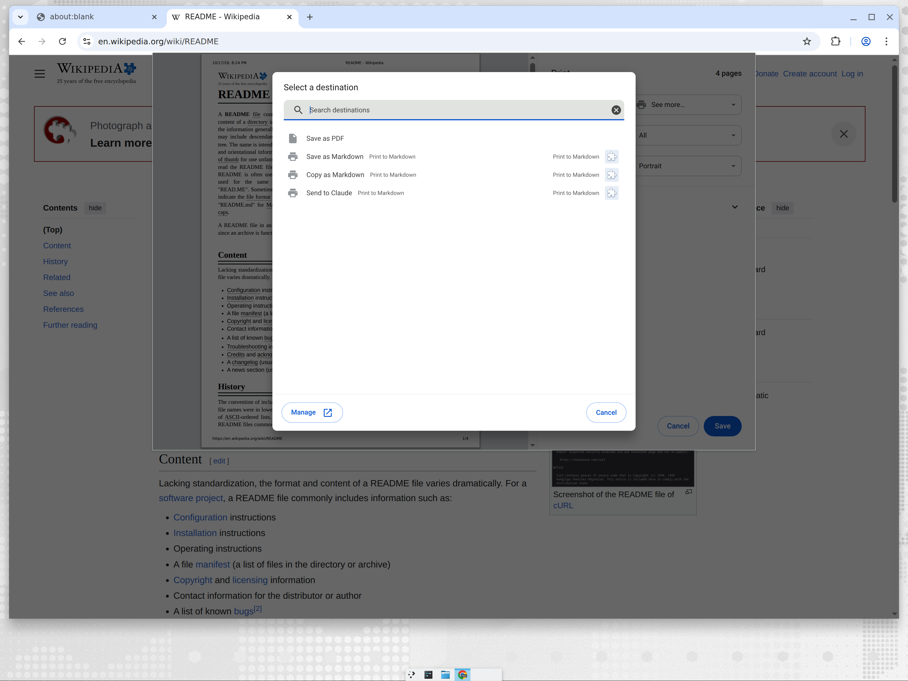

# Print to Markdown

Chrome extension that turns the page you are looking at into Markdown and
saves it, copies it, or hands it to Claude — from the place you already use
to "print to PDF": Chrome's print dialog.



## What you get

| Trigger | How |
| --- | --- |
| Print dialog | `Ctrl/Cmd+P` → Destination → *See more…* → **Save as Markdown**, **Copy as Markdown** or **Send to Claude**. After the first use they show up in the recent destinations list. |
| Toolbar | Click the extension icon → same three buttons. |
| Right-click | *Print to Markdown* submenu on any page or selection. |
| Keyboard | `Alt+Shift+S` save, `Alt+Shift+M` copy, `Alt+Shift+C` send to Claude (change at `chrome://extensions/shortcuts`). |

What gets converted:

- The current selection, if there is one.
- Otherwise the article, as detected by Mozilla's Readability (the same engine
  as Firefox Reader View). When no article is detected, the whole page.
- Conversion is done with Turndown + the GFM plugin: ATX headings, fenced
  code blocks with the language, tables, strikethrough, task lists, absolute
  links and images.
- An optional YAML front matter block with `title`, `source`, `author`,
  `site` and `saved`.

**Send to Claude** opens `https://claude.ai/new?q=<markdown>` with the page
prefilled. When the page is too long for a URL (default limit 20,000
URL-encoded characters) the Markdown is copied to the clipboard and
`claude.ai/new` opens for you to paste.

## Why the print dialog works

Chrome lets extensions register *virtual printers* through the
[`chrome.printerProvider`](https://developer.chrome.com/docs/extensions/reference/api/printerProvider)
API. Each Markdown action is one printer. Chrome hands the extension a PDF
of the page when you press *Print*; the extension ignores the PDF (PDF →
Markdown is lossy) and instead converts the live DOM of the tab that opened
the dialog. Chrome's "Save page as…" dialog and the share menu are not
extensible, which is why those are not offered.

## Install (unpacked)

1. `git clone https://github.com/talayolabs/print-to-markdown && cd print-to-markdown`
2. `npm install && npm run vendor` — copies Readability and Turndown into `extension/vendor/`.
3. Open `chrome://extensions`, enable *Developer mode*, *Load unpacked*, pick the `extension/` folder.

`npm run zip` builds `dist/print-to-markdown.zip` for the Chrome Web Store.

## Options

Open the extension's options page (toolbar popup → *Options*):

- **What to convert**: article when detected (default), article only, or the whole page.
- **Front matter** on/off.
- **Ask where to save** each file (otherwise it goes to the Downloads folder as `<title>.md`).
- **Send to Claude**: prefill the URL (default) or always copy + open.
- **Prefill limit** in URL-encoded characters.

## Layout

```
extension/
  manifest.json          MV3 manifest: printerProvider, scripting, downloads, …
  background.js          wires print destinations, context menu, shortcuts, popup messages
  lib/actions.js         the three actions; runAction(actionId, tab)
  lib/extract.js         injects the converter into the tab, adds front matter, builds the filename
  lib/outputs.js         save (chrome.downloads), copy (offscreen document), send to Claude
  lib/settings.js        defaults + chrome.storage.sync
  content/convert.js     runs in the page: selection / Readability / full page → Turndown
  offscreen/             clipboard writer
  popup/, options/       UI
  vendor/                Readability, Turndown, turndown-plugin-gfm (generated by npm run vendor)
```

## Development notes

- The service worker is cached: after editing files, press *Reload* on the
  extension in `chrome://extensions` (or bump the version).
- In the service worker console, `printToMarkdown.runOnActiveTab("md-copy")`
  runs an action without going through the UI.
- Pages Chrome does not let extensions read (`chrome://`, the Web Store, PDF
  viewer) produce a notification saying so.
